# 🏁 Live Timing de Rally: cronometraje y resultados en vivo

Sistema web de **cronometraje en tiempo real** para competencias de rally: los cronometristas cargan los tiempos desde el panel y el público ve la clasificación actualizada al instante.

Desarrollado y puesto en producción para dos clientes de Tierra del Fuego:
- **A.PI.TU.R. · Rally Fueguino**: 3ª fecha del 31º Campeonato Fueguino de Rally (Río Grande, octubre de 2026).
- **Automóvil Club Río Grande (ACRG) · Súper Especial**, modalidad persecución (31 de octubre y 1 de noviembre de 2026). Misma base adaptada a la identidad, las reglas y las categorías del cliente.

> 🔒 **Código privado (proyecto para clientes).** Este repositorio muestra el sistema en funcionamiento. El código está disponible para revisión en entrevistas técnicas.

---

## ✨ Funcionalidades

**Sitio público**
- Clasificación **general**, **por categoría**, **por etapa** y **clasificación final** (podio por categoría).
- **Resumen de cada prueba especial (PE)** con diferencias contra el primero y contra el auto anterior.
- Solapas de **penalizaciones** (con motivo) e **inscriptos** (nacionalidad, vehículo y categoría).
- Actualización **en vivo**, con indicador de última actualización.
- **Exportación a PDF** de la clasificación.
- Tratamiento de **DNF / abandono**: queda fuera del ordenamiento y no suma tiempo.

**Panel de cronometristas**
- **Login con roles** para el personal.
- Carga de tiempos con **cálculo automático** del tiempo neto (llegada − largada + penalización), con formato rápido para escribir solo números.
- **Cola de carga** con estado de validación, edición y **corrección de tiempos** que se publica al instante.
- **Sincronización de pendientes** ante cortes de conexión.
- El público ve solo el tiempo neto, nunca las horas de largada y llegada.

## 🛠️ Tecnologías

HTML · CSS · JavaScript · **Supabase** (PostgreSQL, autenticación y Realtime) · **Vercel** · generación de PDF en el navegador

---

## 📸 Capturas

### Sitio público: Rally Fueguino (A.PI.TU.R.)

| Clasificación general | Por categoría |
|---|---|
| 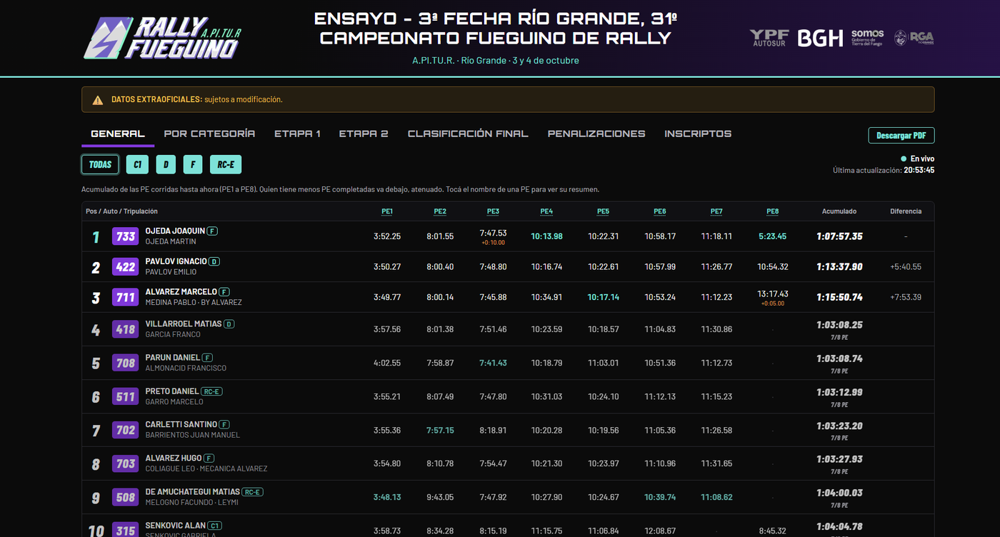 | 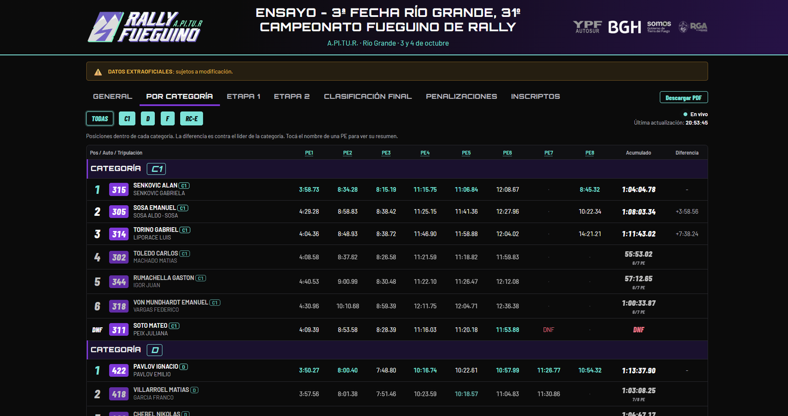 |
| **Resumen de una PE** | **Clasificación final** |
| 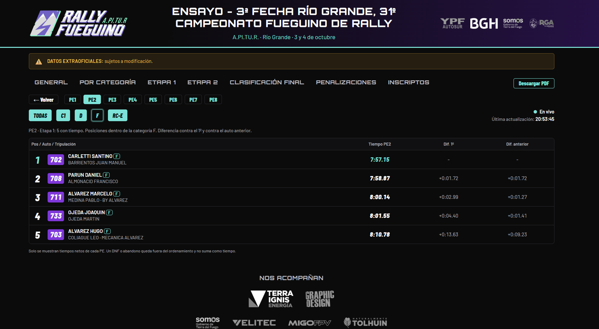 | 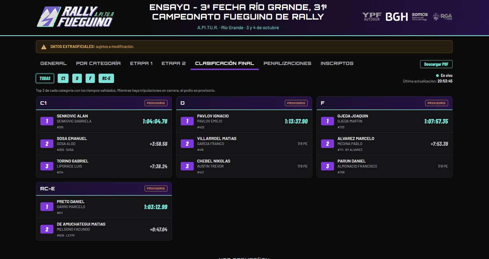 |
| **Penalizaciones** | **PDF exportado** |
| 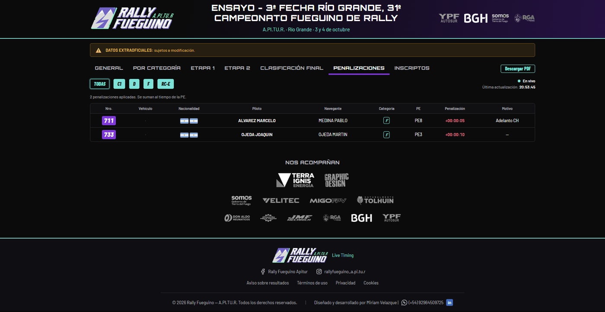 | 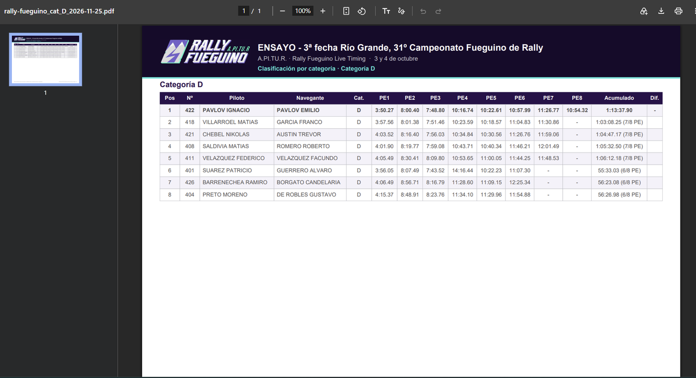 |

### Panel de cronometristas

| Ingreso del personal | Carga y corrección de tiempos |
|---|---|
| 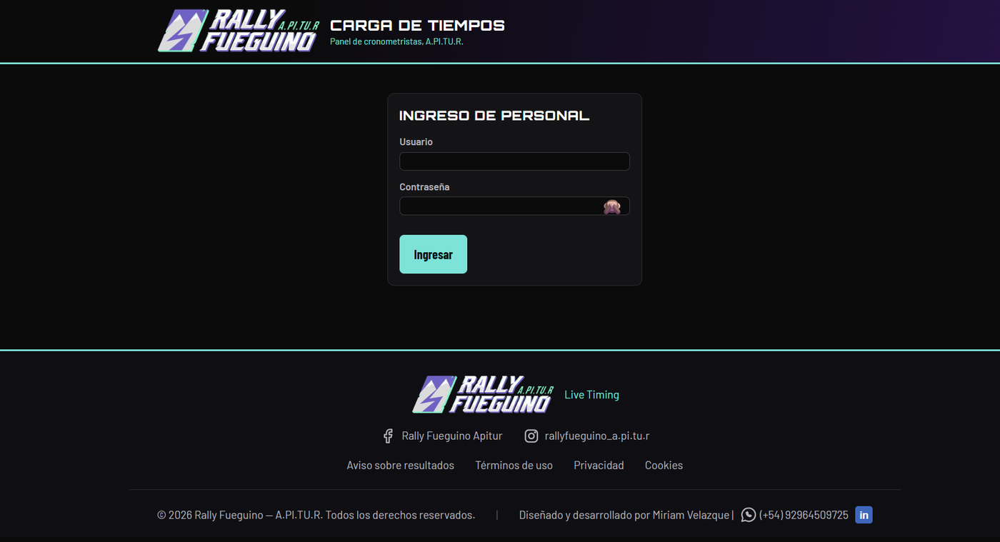 | 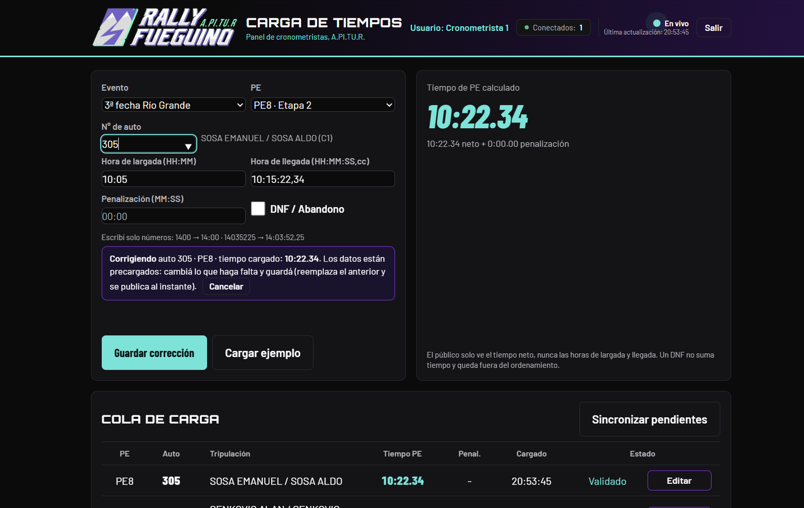 |
| **Cola de carga y validación** | |
| 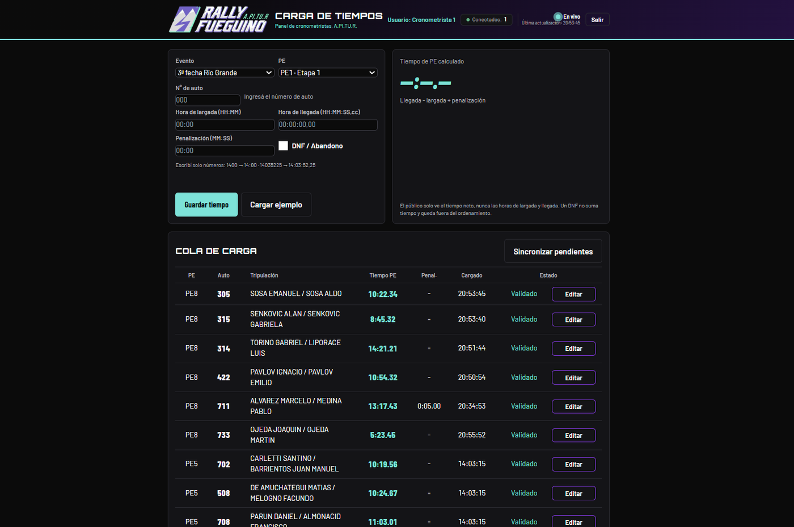 | |

### Segunda implementación: Súper Especial (ACRG)

| Clasificación general | Penalizaciones con motivo |
|---|---|
| 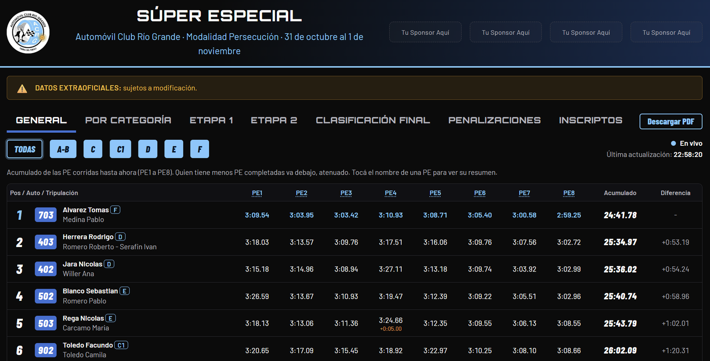 | 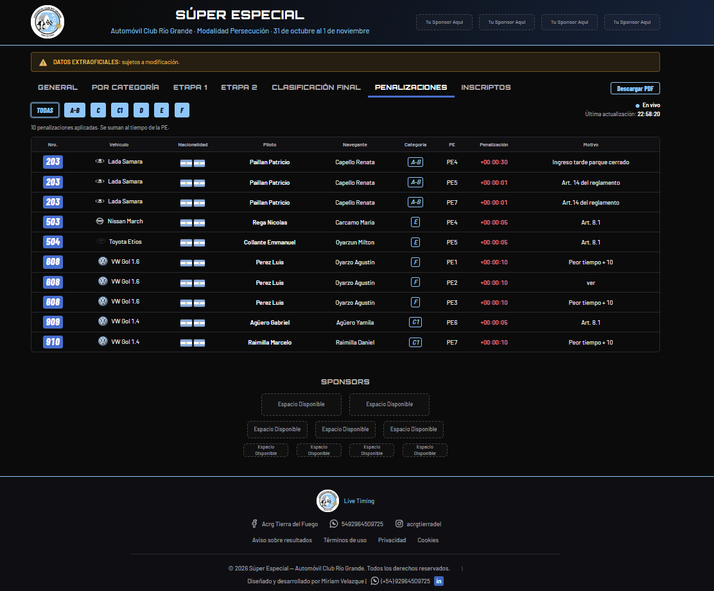 |

---

## 👩‍💻 Autora

**Miriam Alicia Velazque**: diseño, desarrollo y puesta en producción.
[LinkedIn](https://www.linkedin.com/in/miriam-alicia-velazque) · [GitHub](https://github.com/miriamvelazque)
